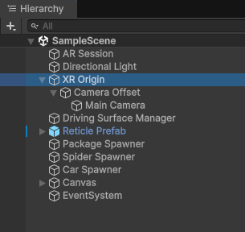
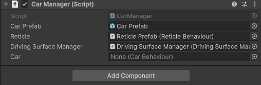
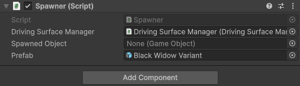

# Augmented Reality with Unity3D and AR Foundation

This report documents the implementation of an academic Augmented Reality (AR)
application developed in Unity3D using AR Foundation and Google ARCore. The
project takes the car game from the official Google
[AR Foundation Codelab](https://developers.google.com/codelabs/arcore-unity-ar-foundation)
as a starting point and extends it with a scoring mechanic based on two kinds
of collectable objects: packages and spiders.

## Objective

The practice requires adapting the Codelab car game so that the car interacts
with two different types of objects placed on the detected plane:

- When the car touches a **package**, the score **increases by 1** and a new
  package appears.
- When the car touches a **spider**, the score **decreases by 1** and a new
  spider appears.
- The current score is **displayed on screen** at all times.

The specific goals are:

- Set up a Unity project with AR Foundation and the ARCore XR Plugin targeting
  Android.
- Reproduce the Codelab base game: plane detection, plane locking, reticle and
  car that follows the reticle.
- Configure the spider in the same way as the package: a prefab with a collider
  in trigger mode and a spawner that places it randomly on the locked plane.
- Implement the new elements: the `Spider` tag and the scoring mechanic.

**Prerequisites**

- An ARCore-compatible Android device.
- Unity with Android Build Support installed.
- AR Foundation and ARCore XR Plugin packages added through the Package Manager.

## System Architecture and Component Configuration

### Scene Hierarchy Overview

The scene follows the structure proposed by the Codelab, adding a second
spawner dedicated to the spiders and a `Canvas` for the score UI.

*Figure 1: Final Scene Hierarchy showing AR Session, XR Origin, Driving Surface
Manager, Reticle Prefab, Package Spawner, Spider Spawner, Car Spawner, Canvas
and EventSystem.*

- **AR Session:** controls the lifecycle of the AR experience.
- **XR Origin:** contains the AR camera and the `ARPlaneManager` and
  `ARRaycastManager` components used for plane detection and raycasting.
- **Driving Surface Manager:** locks the plane selected by the user, which
  becomes the driving surface.
- **Reticle Prefab:** marks the point of the locked plane the user is aiming
  at; the car drives towards it.
- **Package Spawner / Spider Spawner:** place a package or a spider at a
  random position of the locked plane.
- **Car Spawner:** instantiates the car once the plane is locked.
- **Canvas:** holds the `Text` element that shows the score.

### Car Spawner

The `Car Manager` component instantiates the `Car Prefab` and links it with
the reticle and the driving surface manager.

*Figure 2: Inspector configuration of the `Car Manager` component.*

### Spider Spawner

The spider is configured exactly like the package. The `Black Widow Variant`
prefab includes a collider with **Is Trigger** enabled and the `Spider` tag
(the package prefab uses the `Package` tag). The `Spider Spawner` reuses the
same `Spawner` script as the packages, changing only the prefab to instantiate.

*Figure 3: Inspector configuration of the `Spawner` component used for the
spiders, with the `Black Widow Variant` prefab assigned.*

## Scripts

### System Requirements

The specifications required that both packages and spiders reappear after
being collected, and that the car keeps track of a score shown on screen. The
behavior is distributed between two C# scripts: `Spawner.cs` and
`CarBehaviour.cs`.

### Spawner.cs

`Spawner.cs` is a generic version of the Codelab `PackageSpawner`, so it can be
reused for any prefab. In `Update`, it reads the `LockedPlane` from the
`DrivingSurfaceManager`; if there is a locked plane and no spawned object, it
calls `Spawn`, which instantiates the prefab at a random point of the plane.
That point is obtained in `FindRandomLocation` by picking a random triangle of
the plane mesh and a random point inside it with `RandomInTriangle`. Each
frame, the Y coordinate of the spawned object is adjusted to the plane height.
Since the spawner checks `SpawnedObject == null`, destroying the object is
enough to make a new one appear.

### CarBehaviour.cs

`CarBehaviour.cs` moves the car towards the reticle using
`Quaternion.Lerp` for rotation and `Vector3.MoveTowards` for translation. The
scoring mechanic is implemented in `OnTriggerEnter`:

- If the other collider has the `Package` tag, the score is increased by 1.
- If the other collider has the `Spider` tag, the score is decreased by 1.

In both cases the touched object is destroyed, so its spawner creates a new one
in the next frame, and `UpdateScoreUI` refreshes the `Text` component with the
current value (`"Puntos: <score>"`).

## System Testing

The application was built as an Android APK and tested on an ARCore-compatible
mobile device. The following behaviors were verified:

- [x] Planes are detected and one can be locked as the driving surface.
- [x] The car is spawned on the locked plane and follows the reticle.
- [x] A package and a spider appear at random positions of the locked plane.
- [x] Touching a package adds 1 point and a new package appears.
- [x] Touching a spider subtracts 1 point and a new spider appears.
- [x] The score is updated on screen after each collision.

The final build is available in `./apks/ar-foundation.apk`.

## Other Information

This code was developed by
* [Cristhian Adoney Cruz Delgado](https://github.com/CristhianCruzDelgado)

Contact emails
* <alu0101648293@ull.edu.es>

This code was designed for Intelligent Interfaces, \
signature of the Computer Engineering degree, \
that is studied at the Universidad de La Laguna.

_25 November 2026_
